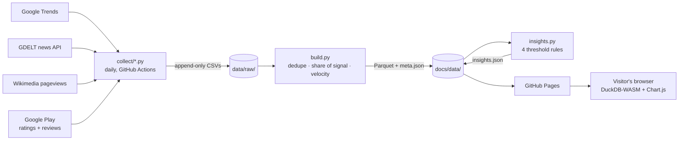

# qcomm-intel

**Who's winning India's 10-minute delivery race?** A free, public competitive intelligence dashboard for Blinkit, Zepto, Swiggy Instamart and Flipkart Minutes, built only from public signals and refreshed every day.

**Live:** https://sarthakkk23.github.io/qcomm-intel/

**Built by [Sarthak Oberoi](https://www.linkedin.com/in/sarthak-oberoi-analyst/)**, data analyst in programmatic advertising · sarthakoberoi12@gmail.com

- **No servers.** GitHub Actions collects the data; GitHub Pages serves static files; DuckDB-WASM runs the SQL in each visitor's browser.
- **No AI.** Every insight sentence comes from a written rule with an explicit threshold, and carries the numbers behind it.
- **No cost.** ₹0 to run: public APIs, free Actions minutes for public repos, free Pages hosting.

## What it shows

| Section | Question it answers |
|---|---|
| This week's insights | What changed enough to matter? (rule-based, ranked by strength) |
| At a glance | Who leads Google search right now, and how are the apps rated? |
| Share of signal | How does each brand's share of search, Wikipedia attention or news move over time? (filterable, shareable links) |
| App momentum | Which app is gaining Play Store ratings fastest? |
| Complaint radar | What are unhappy customers complaining about: late delivery, wrong items, fees, refunds, support or the app? |
| State by state | Who leads search in each Indian state? |
| Ask in SQL | Anything else: query the tables directly, in the browser |

## How it works



1. **Collect** (`collect/`): three collectors call four public sources and write one CSV per day in a shared long format: `fetch_date, date, brand, source, metric, value`. One source failing never stops the others; gaps are logged, not crashed on.
2. **Build** (`build.py`): stacks every raw file, drops same-day partial data, keeps the latest fetch for each `(date, brand, source, metric)`, and computes share of signal and Play Store velocity into Parquet.
3. **Insights** (`insights.py`): four deterministic rules compare this week with last week and write `insights.json`.
4. **Dashboard** (`docs/index.html`): one static page. DuckDB-WASM loads the Parquet files (~32 KB) and every chart, filter and the SQL box query them locally.

The workflow (`.github/workflows/daily.yml`) runs all of this every morning and commits the results.

## Sources

| Source | Collector | Signal | Window per run |
|---|---|---|---|
| Google Trends (pytrends) | `collect/trends.py` | Search interest for all 4 brands in one request; 30-day share by state | Last 30 days |
| GDELT DOC 2.0 API | `collect/news.py` | Daily article count and average tone per brand | Last 30 days |
| Wikimedia pageviews API | `collect/attention.py` | Daily human pageviews (Blinkit, Zepto) | Last 30 days |
| Google Play (google-play-scraper) | `collect/attention.py` | Rating, rating count and review count of each standalone app | Today's snapshot |
| Google Play reviews (google-play-scraper) | `collect/reviews.py` | Share of each app's 400 newest English reviews that are 1–2★ complaints, by theme | Today's sample |

## Insight rules

| Rule | Fires when | Why this threshold |
|---|---|---|
| `share_shift` | A brand's 7-day average share of signal moves ≥ 2.0 pts (search) or ≥ 3.0 pts (Wikipedia) vs the previous 7 days | Re-fetching Trends on the same day moved shares by ~0.2 pts; 2.0 is 10× that noise |
| `rating_shift` | A brand's 7-day average Play rating moves ≥ 0.03 stars week on week | A young app's rating moves about this much day to day; weekly means smooth it |
| `velocity_shift` | New Play ratings per day change ≥ 50% week on week | Snapshot timing varies with cron delays; only large weekly moves are signal |
| `complaint_shift` | The share of recent reviews that are 1–2★ complaints about a theme moves ≥ 3.0 pts week on week | A 400-review sample has ~1.5 pts sampling error at a 10% rate |
| `tone_flip` | Article-weighted news tone changes sign with a swing ≥ 1.0, and ≥ 5 articles in each week | Tone from one or two articles is one journalist's mood |

Every rule needs at least 5 days of data in each week, or it stays silent. Each insight records its value, threshold, strength and date window.

## Design decisions worth knowing

- **Overlapping windows make the pipeline self-healing.** Each run re-fetches the last 30 days, so a day lost to a rate limit is backfilled by the next successful run.
- **Latest fetch wins.** Deduplication keeps the newest fetch per key (the `ROW_NUMBER() OVER (PARTITION BY … ORDER BY fetch_date DESC) = 1` pattern).
- **Share of search, not the raw index.** Google rescales each request to its own 0–100. Share (brand ÷ sum of the four) cancels that out; a same-day re-fetch moved the raw index 89→91 but the 30-day share only 55.0→54.8%.
- **Missing is not zero.** Days a source didn't report stay empty, and a share is only computed when every expected brand has data.
- **Fail soft, never hang.** Per-call retries with backoff, a hard per-call deadline for the Play Store scraper (`signal.alarm`), a 20-minute time budget for GDELT, and `continue-on-error` per workflow step.
- **Aggregates only for reviews.** Review text, usernames and IDs are read in memory and discarded; only percentages per theme are stored. Complaints count only 1–2★ reviews, so praise like "support is excellent" never counts.
- **Safe SQL in the browser.** Chart filters use prepared statements; visitors' own SQL runs only in their own tab.

## Run it locally

```bash
python3.12 -m venv .venv && .venv/bin/pip install -r requirements.txt
.venv/bin/python collect/attention.py   # also: collect/trends.py, collect/news.py
.venv/bin/python build.py
.venv/bin/python insights.py
.venv/bin/python -m http.server 8000 --directory docs   # open http://localhost:8000
```

## By the numbers (as of 16 Oct 2026)

| | |
|---|---|
| Public sources | 4 (Google Trends, GDELT, Wikimedia, Google Play) |
| Rows collected | 963 raw rows in 11 daily files (675 time-series + 288 state rows) |
| Data points on the dashboard | 763 (429 signals, 194 share-of-signal rows, 140 state rows), covering 11 Sep – 16 Oct 2026 |
| Insight rules | 5 |
| Daily refresh time | ~25–29 min end to end; everything except GDELT takes under 2 min (GDELT spends the rest waiting out rate limits, capped at 20 min) |
| Data shipped to the browser | ~32 KB of Parquet + JSON |
| Code | ~1,680 lines (Python collectors, build and rules; one HTML page; one workflow) |
| Hosting cost | ₹0 |

Build history with timestamps per stage: [RUNLOG.md](RUNLOG.md).

## Limitations

- **Complaint radar is keyword-based and English-only.** It samples each app's 400 newest reviews requested in English (Devanagari Hindi reviews are not included; common Hinglish words are). A hand check of 36 random matches on 2026-10-16 found 32 correct (~89%); the main error was the word "stuck", which was then narrowed. 40–60% of 1–2★ reviews match no theme and are reported as "unclassified". For Blinkit 400 reviews cover a few hours; for Flipkart Minutes about two weeks, so small apps' daily samples overlap.
- **Ad creatives are not tracked.** The original plan included a monthly manual snapshot of active ads from Meta Ad Library and Google Ads Transparency Center. It was dropped: Meta's terms do not allow automated collection, its Ad Library API only covers political and social-issue ads in India, and a consistent manual snapshot (about 100 hand-labelled ads a month) was not worth the upkeep for this project. Every remaining source is fully automated.
- **GDELT rate limits (news).** The DOC 2.0 API returns HTTP 429 more aggressively than its stated "one request every 5 seconds"; on 2026-10-11 the Blinkit tone call failed 5 times over ~5 minutes. The collector spaces calls 30s apart, retries with exponential backoff, and logs any brand/metric it could not fetch as a gap instead of failing the run. Because every run re-fetches the last 30 days, a missed day is backfilled by the next successful run.
- **GDELT volume is low for these brands.** Over 30 days to 2026-10-10: Blinkit ~65 articles, Swiggy Instamart 36, Flipkart Minutes 16 (single digits per day). Daily average tone on 1–2 articles is noisy, so tone-based insights require a minimum article count.
- **GDELT has missing days of its own.** For the 30 days to 2026-10-10 the API returned the same 17 dates for every brand (with explicit 0s for days without matches) and nothing for the other 13 (e.g. 14–19 Sep, 3–5 Oct). Those are gaps in GDELT's processing, not zero coverage, so they are stored as missing (NULL), never filled with 0.
- **GDELT throttling is severe from some networks.** On the first full run, 5 of 8 calls failed after 3 retries each, even after a 40-minute cooldown. Likely cause: carrier-grade NAT, where many broadband customers share one public IPv4 address. Reliability from GitHub Actions runners is tracked in RUNLOG. If it stays poor, the fallback is Google News RSS search for daily article counts (no tone).
- **No Wikipedia page for Swiggy Instamart or Flipkart Minutes.** Only their parent companies (Swiggy, Flipkart) have English Wikipedia articles, and parent pageviews are not comparable to a single quick-commerce brand. Wikipedia pageviews are collected for Blinkit (`Blinkit`) and Zepto (`Zepto_(company)`, since plain `Zepto` redirects to "Metric prefix") only, and Wikipedia share-of-signal compares those two.
- **Google Trends is a relative index, not search volume.** All four brands are fetched in one request, so their values share one 0–100 scale, but each request is rescaled to its own peak. The dashboard therefore uses share of search (brand ÷ sum of the four brands that day), which is comparable across fetches. The search term for Swiggy Instamart is `Instamart`, which also matches queries such as "swiggy instamart".
- **State-level share of search favours small markets.** Each state's four values sum to 100, i.e. they show the split between the brands, not the size of the state. A brand can lead in Sikkim or Nagaland with very little absolute search. States whose four values are all 0 (e.g. Lakshadweep) lack enough search volume and are treated as missing, not as 0% share.
- **Google Trends throttles too.** On 2026-10-15 the request returned HTTP 429 twice and succeeded on the third attempt after 60s + 120s of backoff. Google is known to block cloud IPs such as GitHub Actions runners. If it fails persistently there, the fallback is a manual CSV export from trends.google.com, dropped into `data/raw/trends/` in the shared schema.
- **Play Store tracks standalone quick-commerce apps only.** Instamart (`in.swiggy.android.instamart`, launched Jan 2025) and Flipkart Minutes (`com.flipkart.minutes.android`, launched 11 Sep 2026 as a limited beta) also live inside their parent apps (Swiggy, Flipkart), whose ratings mix in food delivery and general e-commerce. Standalone totals are therefore not market-size measures; insights use day-on-day change in rating and review counts, not totals. Minutes' standalone app is a month old (≈5.9k ratings at first snapshot), so most Minutes usage is not captured.
- **Daily refresh time varies.** The workflow is scheduled for 07:00 IST, but GitHub delays scheduled runs under load; the first scheduled run started at 11:37 IST. Day-to-day Play Store velocity (new ratings per day between consecutive snapshots) is therefore noisy: on 2026-10-16 the snapshots were only 14 hours apart but counted as one day. Insights compare 7-day averages, which cancel most of this timing noise, and Play Store ratings for a young app (Flipkart Minutes, ~8k ratings) move ±0.03 stars day to day.
- **Play Store data is a daily snapshot with no history.** Unlike GDELT and Wikipedia, a failed Play Store fetch cannot be backfilled later; a missed day stays missing. `google-play-scraper` has no network timeout, so the collector sets a 30s socket timeout to avoid hanging the daily run.
